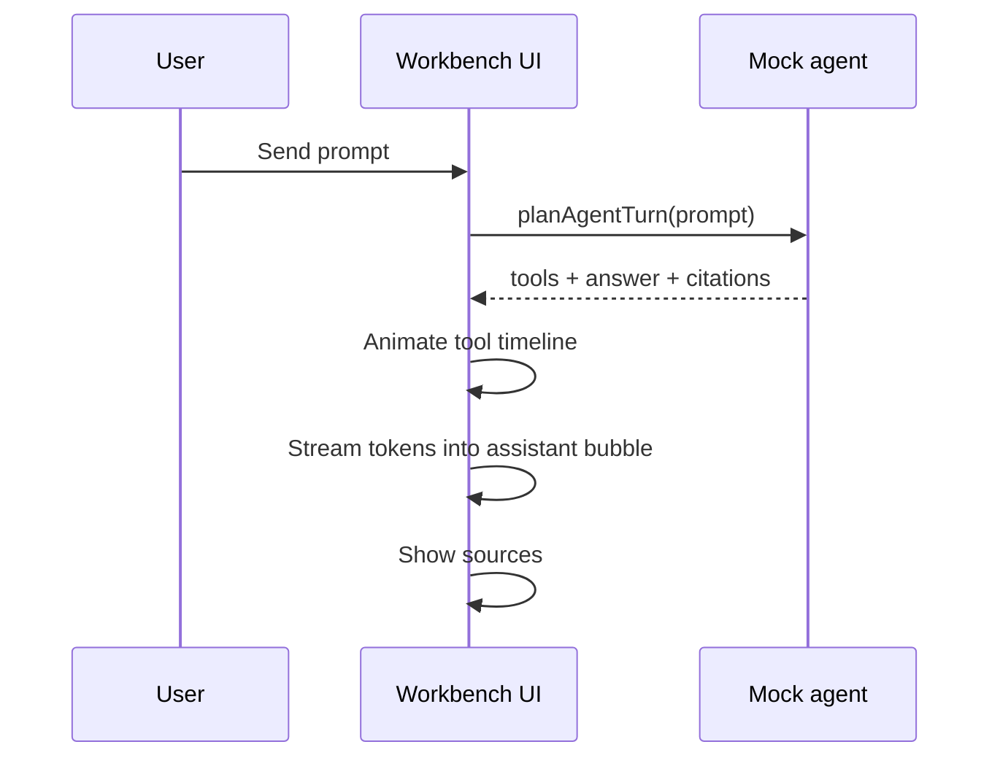

# AI Assistant Workbench

A **frontend-heavy** portfolio UI for an AI assistant desk (FDE-adjacent product surface). Everything is **mocked locally** — no paid APIs, no backend.

**Author:** Malini Anne \<malinia7979@gmail.com\>

## What it is

A React + TypeScript + Vite workbench with four panels:

1. **Conversation** — chat with a simulated token stream (`setTimeout` deltas)
2. **Tool-call timeline** — fake tools `search_docs` and `create_ticket`
3. **Sources / citations** — grounding snippets from the mock doc catalog
4. **Settings** — model name, temperature, system prompt (display + stream jitter only)

## Architecture

```
User message
    │
    ▼
┌───────────────────┐
│ mockAgent.plan()  │  decide tool calls + final answer text
└─────────┬─────────┘
          │
          ├─► Tool timeline: pending → running → success
          │
          ├─► Sources panel: citations from search_docs
          │
          └─► Conversation: simulateTokenStream(answer)
```



## What YOU built vs what is mocked

| Piece | Built | Mocked |
|-------|-------|--------|
| Multi-panel AI product layout | Yes | — |
| Streaming chat UX | Yes (UI) | Tokens from timer, not SSE |
| Tool timeline UX | Yes | Tools do not hit real APIs |
| Citations panel | Yes | Static mock catalog |
| Settings controls | Yes | No real model is called |

## How to run

```bash
cd ai-assistant-workbench
npm install
npm run dev
```

```bash
npm run typecheck
npm run build
npm run preview
```

## Key files to review first

1. `src/App.tsx` — turn lifecycle orchestration
2. `src/lib/simulateStream.ts` — fake token stream + why SSE matters
3. `src/lib/mockAgent.ts` — tool plan + answer assembly
4. `src/components/ToolTimeline.tsx` — agent transparency UX
5. `src/components/ConversationPanel.tsx` — streaming cursor pattern

## Interview talking points

- AI product UX: streaming, tool transparency, citations, settings
- How you'd swap `simulateTokenStream` for EventSource/fetch streams
- Difference between chat completion vs tool-calling agent loops
- Temperature as a product control (and what it actually does in LLMs)
- Angular → React: same component composition and TypeScript discipline

See **INTERVIEW.md** for rehearsable Q&A.
